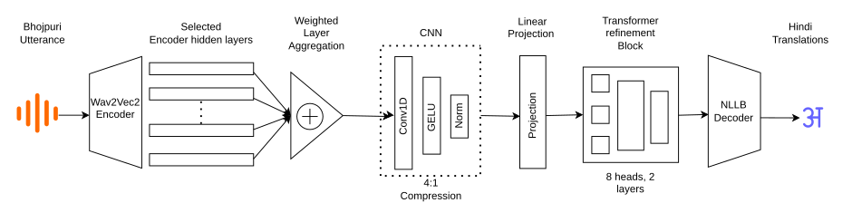
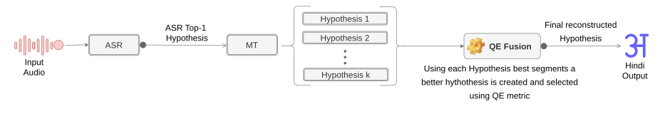

# IIIT-BGP at IWSLT 2026: Low-resource Bhojpuri to Hindi Speech Translation

Code for the paper **"IIIT-BGP IWSLT 2026 Systems for Low-resource ST"** (Singh, Dipanshu, Singh, Rishu), IWSLT 2026, pages 272-283.
Paper: <https://aclanthology.org/2026.iwslt-1.31/>

The repository contains two Bhojpuri to Hindi speech translation systems built for the IWSLT 2026 low-resource shared task:

- **End-to-end (E2E):** a Bhojpuri Wav2Vec2 encoder connected to an NLLB-200 decoder through a trained interconnection adapter, with optional decoder LoRA.
- **Cascade:** Whisper large-v3 for Bhojpuri ASR, NLLB-200 for MT, and QE Fusion with COMET-Kiwi in place of beam search.

## Results

IWSLT 2026 Bhojpuri to Hindi.

| System | Dev BLEU | Dev chrF++ | Test BLEU | Test chrF++ |
|---|---|---|---|---|
| Primary: E2E, adapter + decoder LoRA + augmentation | 32.77 | 53.43 | 12.1 | 34 |
| Contrastive 1: E2E, + cross-attention and top-2 decoder layers unfrozen | 30.23 | 51.56 | 12.3 | 35 |
| Contrastive 2: cascade, Whisper + NLLB + QE Fusion | 16.09 | 41.37 | 10.1 | 39 |

Cascade ablation on the dev set:

| Pipeline | BLEU | chrF++ | COMET |
|---|---|---|---|
| ASR + MT (beam search) | 15.96 | 41.23 | 0.5394 |
| ASR + MT (QE Fusion) | 16.09 | 41.37 | 0.5569 |

The large dev-to-test drop of the E2E systems is analysed in Section 7 of the paper. The main causes are label/audio mismatches in the official data and an adapter that is trained from scratch on a small corpus.

## Architecture

### End-to-end



Hidden states from Wav2Vec2 layers 6, 8, 10 and 12 are combined with learnable softmax weights, compressed 4:1 by two stride-2 Conv1d layers, projected to the NLLB hidden size and refined by a 2-layer Transformer. The result replaces the NLLB encoder output, and the NLLB decoder cross-attends to it. LoRA (rank 8, alpha 16) is applied to the decoder `q_proj` and `v_proj` layers.

### Cascade



Whisper large-v3 is fine-tuned with LoRA on Bhojpuri speech (adapters are merged afterwards). Its top-1 transcript is translated by a fine-tuned NLLB-200. QE Fusion samples 5 candidates with epsilon sampling (epsilon 0.02, temperature 0.5), recombines spans between them, and keeps the best hypothesis according to `Unbabel/wmt22-cometkiwi-da` (reconstruction beam 4).

## Repository layout

```
asr/    Whisper large-v3 LoRA fine-tuning for Bhojpuri ASR
mt/     NLLB fine-tuning, MT data, QE Fusion cascade inference
e2e/    End-to-end model, training, augmentation and inference
docs/   Architecture diagrams
```

Each folder has its own `pyproject.toml` and `uv.lock`, so each can be installed on its own. All commands below are run from inside that folder.

## Data

| Data | Used for | Size | Source |
|---|---|---|---|
| IWSLT 2026 official Bhojpuri-Hindi ST | E2E training and all evaluation | 20h train, 2h dev, 0.5h test | <https://github.com/shashwatup9k/iwslt2026_bho-hi> |
| `ai4bharat/Rural_Women_Bhojpuri` (real + synthetic) | Whisper ASR fine-tuning | 7h real (+0.6h dev), 4.2h synthetic | Hugging Face |
| Kaggle Bhojpuri-Hindi corpus | NLLB fine-tuning | 44.7k sentence pairs after de-duplication | Kaggle |
| Back-translated pairs | NLLB fine-tuning | 54.7k pairs, generated with `facebook/nllb-200-1.3B` | built from the official training set |
| Speed-perturbed official data | E2E augmentation | about 26h from the 20h train set | `e2e/e2e_v1/augument.py` |

The cleaned MT splits used here are in `mt/data/MT_data/clean_data/` (`train.csv`, `dev.csv`, `test.csv`, columns `bho,hin`). `mt/data/MT_data/noisy_data/` holds the unfiltered variant and `mt/helper/dataset_builder.py` rebuilds the splits from the raw pairs.

The E2E scripts download the official data from GitHub into `--data_dir` if it does not exist yet. The resulting layout is:

```
data/iwslt2026_bho_hi/iwslt2024-2025_bho-hi/train/   stamped.tsv, txt/train.hi, wav/
data/iwslt2026_bho_hi/iwslt2024-2025_bho-hi/dev/     stamped.tsv, txt/dev.hi, wav/
data/iwslt2026_bho_hi/test-2026/                     stamped.tsv, wav/
```

`stamped.tsv` has one tab-separated line per utterance (`wav_path`, `start`, `duration`, no header) and `txt/<split>.hi` has the aligned Hindi translations.

## Pretrained weights

All weights are published on Hugging Face in `safetensors` format.

| Submission | Hugging Face repo | Contents |
|---|---|---|
| Primary (end-to-end) | [`kaustuk000/iwslt2026-bho-hin-e2e`](https://huggingface.co/kaustuk000/iwslt2026-bho-hin-e2e) | Wav2Vec2 + adapter + NLLB decoder with LoRA, epoch 40 (dev BLEU 32.77) |
| Contrastive 2 (cascade), ASR | [`kaustuk000/iwslt2026-bho-whisper-large-v3`](https://huggingface.co/kaustuk000/iwslt2026-bho-whisper-large-v3) | Whisper large-v3, LoRA merged |
| Contrastive 2 (cascade), MT | [`kaustuk000/iwslt2026-bho-hin-nllb-mt`](https://huggingface.co/kaustuk000/iwslt2026-bho-hin-nllb-mt) | Fine-tuned NLLB-200 (epoch 3, best dev BLEU) |

Run from the repository root:

```bash
hf download kaustuk000/iwslt2026-bho-whisper-large-v3 --local-dir weights/asr
hf download kaustuk000/iwslt2026-bho-hin-nllb-mt      --local-dir weights/mt
hf download kaustuk000/iwslt2026-bho-hin-e2e          --local-dir weights/e2e
```

The e2e file is a full model state dict. Tied tensors are stored once and recorded in the file metadata (`aliases`); the model card shows how to restore them before `load_state_dict`.

## Installation

Python 3.12 and a CUDA GPU are required. Install with [uv](https://docs.astral.sh/uv/):

```bash
git clone https://github.com/kaustuk000/IWSLT2026.git
cd IWSLT2026/e2e      # or asr, or mt
uv sync
```

The `mt` environment also installs `unbabel-comet`, which is needed for QE Fusion and COMET scoring. Access to `Unbabel/wmt22-cometkiwi-da` is gated on Hugging Face; accept its licence and run `hf auth login` first.

## Usage

### 1. ASR fine-tuning (Whisper)

```bash
cd asr
uv run python WhisperLv3FT.py
```

Hyperparameters are constants at the top of `WhisperLv3FT.py`. The script downloads `ai4bharat/Rural_Women_Bhojpuri`, trains LoRA adapters, selects the best epoch by WER, merges the adapters and writes the final model to `whisper-bhojpuri-final/` (override the output root with `WORK_DIR`). Per-epoch metrics go to `epoch_summary.csv` and `results_table.csv`.

`REAL_SAMPLES`, `SYNTHETIC_SAMPLES`, `VAL_SIZE` and `TEST_SIZE` set how many samples are streamed from the dataset.

### 2. MT fine-tuning (NLLB)

```bash
cd mt
uv run python model/mt_v1.py \
    --train_file data/MT_data/clean_data/train.csv \
    --dev_file   data/MT_data/clean_data/dev.csv \
    --model_name facebook/nllb-200-distilled-600M \
    --epochs 10 --batch_size 16 --lr 1e-4
```

Training uses Adafactor with gradient clipping at 1.0. The best checkpoint by dev BLEU is saved as `model-mt-v1_best` (set the prefix with `--run_name`), and training can be continued with `--resume model-mt-v1_best`.

### 3. Cascade inference with QE Fusion

```bash
cd mt
uv run python inferences/inference_qefusion.py \
    --asr_model  ../weights/asr \
    --mt_model   ../weights/mt \
    --data_root  ../data/iwslt2026_bho_hi/iwslt2024-2025_bho-hi/dev \
    --zeroshot --zeroshot_mode skip_s2 \
    --qe_fusion mt --qe_n_candidates 5 --qe_beam_size 4 --qe_epsilon 0.02 \
    --asr_calc_metrics --mt_calc_metrics \
    --output_dir ./cascade_outputs
```

`--qe_fusion none` gives the beam-search baseline. The script writes transcripts, translations, candidate lists (`qe_candidates.jsonl`) and a score summary (`scores.json`, `scores_summary.txt`) to `--output_dir`.

The pipeline also has an optional LLM-based ASR corrector (Stage 2, `model/train_asr_corrector_exp1.py`). The submitted system does not use it, so the command above passes `--zeroshot_mode skip_s2`.

### 4. End-to-end augmentation, training and inference

Optional offline augmentation (adds spectrogram-masked copies of the training split to the manifest):

```bash
cd e2e/e2e_v1
uv run python augument.py --data_dir ../../data/iwslt2026_bho_hi --split train
```

Training, primary configuration (adapter + decoder LoRA), from `e2e/e2e_v1`:

```bash
uv run python train.py \
    --asr_url   Harveenchadha/vakyansh-wav2vec2-bhojpuri-bhom-60 \
    --nllb_url  facebook/nllb-200-distilled-600M \
    --data_dir  ../../data/iwslt2026_bho_hi \
    --aggregation_layers 6 8 10 12 \
    --adapter_type m_adapter \
    --unfreeze_decoder_lora \
    --epochs 40 --batch_size 4 --lr 1e-4 \
    --eval_beams 5 --eval_no_repeat_ngram_size 3 --eval_repetition_penalty 1.2 \
    --output_dir ./checkpoints
```

Contrastive 1 additionally passes `--unfreeze_decoder_top 2`. Omit `--adapter_type m_adapter` to train the CNN-only adapter (`length`). Checkpoints (`best_model.pt`, `latest_model.pt`, periodic snapshots), `train_log.csv` and `run_config.json` are written to `--output_dir`.

To run inference with the released weights, convert them to the `.pt` format that `inference.py` loads (from the repository root, after downloading the weights as described under Pretrained weights):

```bash
python - <<'PY'
import json, torch
from safetensors import safe_open
with safe_open("weights/e2e/model.safetensors", "pt") as f:
    sd = {k: f.get_tensor(k) for k in f.keys()}
    aliases = json.loads(f.metadata()["aliases"])
sd.update({a: sd[t] for a, t in aliases.items()})
torch.save(sd, "weights/e2e/best_model.pt")
PY
```

Inference on a split that contains `stamped.tsv` and `wav/`, from `e2e/e2e_v1`:

```bash
uv run python inference.py \
    --checkpoint_path ../../weights/e2e/best_model.pt \
    --asr_url   Harveenchadha/vakyansh-wav2vec2-bhojpuri-bhom-60 \
    --nllb_url  facebook/nllb-200-distilled-600M \
    --test_dir  ../../data/iwslt2026_bho_hi/test-2026 \
    --output_dir ./test_predictions \
    --adapter_type m_adapter --unfreeze_decoder_lora \
    --eval_beams 5 --eval_no_repeat_ngram_size 3 --eval_repetition_penalty 1.2
```

The architecture flags must match those used in training. If a `run_config.json` sits next to the checkpoint, inference reads it for you.

### Running on a PBS cluster

`asr/run_asr_metacentrum.sh`, `mt/run_mt_metacentrum.sh` and `e2e/run_e2e_metacentrum.sh` are the PBS job scripts used on MetaCentrum. They contain cluster-specific paths (`PROJECT_DIR`) that must be edited before use.

## Citation

```bibtex
@inproceedings{singh-etal-2026-iiit,
    title = "{IIIT}-{BGP} {IWSLT} 2026 Systems for Low-resource {ST}",
    author = "Singh, Kaustuk Pratap and Dipanshu and Singh, Vedant and Rishu, Kumar",
    booktitle = "Proceedings of the 23rd International Conference on Spoken Language Translation (IWSLT 2026)",
    month = jul,
    year = "2026",
    address = "San Diego, California, US",
    publisher = "Association for Computational Linguistics",
    pages = "272--283",
    url = "https://aclanthology.org/2026.iwslt-1.31/",
}
```

## License

MIT, see [LICENSE](LICENSE).
